# `database/` · Base de datos de ALUNA IA (SABIA & CEIBA)

PostgreSQL 16. Esta carpeta es la **dueña del esquema y de los datos semilla**; el backend
(`backend/`) solo contiene los modelos de SQLAlchemy y la lógica.

```
database/
├── Dockerfile               # imagen postgres:16-alpine + scripts de init/
├── init/00_configuracion.sql  # zona horaria de Colombia y rol de solo lectura (1.ª vez)
├── alembic.ini              # configuración de migraciones
├── migrations/versions/
│   ├── 0001_esquema_inicial_de_sabia.py   # módulo de Salud SABIA (offline-first)
│   └── 0002_plataforma_aluna.py           # usuarios únicos + ALUNA (saberes, custodia, IA, bienestar)
├── seeds/
│   ├── aluna_saberes.json   # 6 perfiles demo, 5 comunidades, 6 saberes, solicitudes y borradores IA
│   └── salud_sabia.json     # relatos, hospitales, plantas, encuentros, alertas del módulo de Salud
├── schema/
│   ├── esquema_completo.sql         # DDL de referencia generado desde las migraciones
│   ├── politicas_rls.sql            # Row-Level Security opcional (defensa en profundidad)
│   └── contrato_original_aluna.sql  # contrato acordado con el equipo (referencia)
└── scripts/
    ├── respaldar.ps1        # pg_dump → database/respaldos/
    └── restaurar.ps1        # restaura un respaldo
```

## Cómo se crea

1. `docker compose up -d --build` construye esta imagen (`aluna-database`) y crea el volumen `pgdata`.
2. Al arrancar, el backend ejecuta `alembic -c /database/alembic.ini upgrade head` y luego
   `python -m app.seed`, que carga `seeds/` **solo en tablas vacías** (no duplica nada).

Sin Docker, desde `backend/`:

```bash
alembic -c ../database/alembic.ini upgrade head
python -m app.seed
```

Nueva migración tras cambiar un modelo:

```bash
cd backend
alembic -c ../database/alembic.ini revision --autogenerate -m "describe el cambio"
```

## Modelo de datos

```mermaid
erDiagram
  users ||--o{ memberships : "pertenece"
  communities ||--o{ memberships : "integra"
  knowledges ||--|{ knowledge_owners : "titulares"
  communities ||--o{ knowledge_owners : ""
  knowledges ||--|{ approvals : "consenso por comunidad"
  knowledges ||--o{ access_requests : ""
  users ||--o{ access_requests : "solicita"
  knowledges ||--o{ access_grants : "permiso explícito"
  users ||--o{ access_grants : ""
  users ||--o{ affiliation_requests : "pide vinculación"
  knowledges ||--o{ ai_generations : "derivados IA (borrador)"
  users ||--o{ audit_events : "bitácora"
  users ||--o{ solicitudes_orientacion : "bienestar (aislado)"
  canales_bienestar ||--o{ solicitudes_orientacion : ""
  users ||--o{ alertas_veredales : "salud SABIA"
  users ||--o{ reportes_derechos : "salud SABIA"
  users ||--o{ gastos_cosecha : "salud SABIA"
```



| Área | Tablas |
|---|---|
| Identidad y territorio | `users` (identidad de participación), `communities` (+ `modulo_salud`), `memberships` (pertenencia y custodia **por comunidad**), `affiliation_requests` |
| SABIA · saberes | `knowledges` (permisos granulares en JSON), `knowledge_owners`, `approvals` (aprobación unánime), `access_requests`, `access_grants` |
| CEIBA · IA | `ai_generations` (derivados en borrador hasta que la custodia titular los aprueba) |
| Trazabilidad | `audit_events` |
| Bienestar (aislado de Ceiba) | `canales_bienestar`, `solicitudes_orientacion` |
| Salud SABIA (offline-first) | `relatos`, `podcasts`, `lugares`, `plantas`, `historias_producto`, `encuentros`, `inscripciones`, `investigaciones`, `solicitudes_investigacion`, `semillas_trueque`, `solicitudes_trueque`, `alertas_veredales`, `reportes_derechos`, `gastos_cosecha`, `cuadernos_cosecha` |

Los registros que se pueden crear sin señal guardan su estado de sincronización:
`client_id` (UUID del teléfono, evita duplicados), `origen` (`en_linea` | `cola_offline`),
`creado_en_cliente` y `sincronizado_en`.

## Accesos útiles

| Qué | Valor |
|---|---|
| Base / usuario | `sabia` / `sabia` (contraseña en `POSTGRES_PASSWORD`, por defecto `sabia_local`) |
| Rol de solo lectura | `aluna_lectura` / `lectura_local` (cámbiala fuera de tu equipo) |
| Consola SQL | `docker compose exec db psql -U sabia -d sabia` |
| Reiniciar todo | `docker compose down -v && docker compose up -d --build` |
